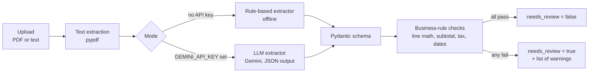

# Invoice Extractor

[](https://github.com/shorif-mahmud-abdullah/invoice-extractor/actions/workflows/ci.yml)


Upload an invoice (PDF or text) and get back **validated, ERP-ready JSON**. Extraction is the easy half. The part that matters in production is catching the cases where the extracted numbers are wrong before they reach an accounting system, so every result is checked with business rules and flagged for human review when something does not add up.

This is a small, runnable demo of the pattern I use in document-AI work: **extract, validate, route exceptions to a human**. It uses made-up sample invoices only.

## How it works



- **Two extractors behind one interface.** The rule-based one runs offline with no API key, which keeps the demo and the tests runnable anywhere. The LLM one handles messy layouts. Its output is parsed into the same typed schema, so a malformed model answer fails loudly instead of slipping through.
- **Validation is the safety net.** It checks that quantity x unit price equals each line amount, that line items add up to the subtotal, that subtotal plus tax equals the total, that required fields exist, and that the due date is not before the invoice date. Amounts use `Decimal`, never floats.
- **Honest failure modes.** Empty files, corrupt PDFs and oversized uploads return clear 4xx errors. Scanned images need OCR and are rejected with a message saying so.

## Quick start

```bash
git clone https://github.com/shorif-mahmud-abdullah/invoice-extractor.git
cd invoice-extractor
python -m venv .venv && source .venv/bin/activate
pip install -r requirements.txt
uvicorn app.main:app --reload
```

Open http://localhost:8000/docs, choose `POST /extract`, and upload a file from `samples/`. Or use curl:

```bash
curl -F "file=@samples/invoice_001.txt" http://localhost:8000/extract
```

To use the LLM extractor, set a Gemini key. The default `auto` mode switches to it automatically, and `?mode=rules` or `?mode=llm` forces one:

```bash
export GEMINI_API_KEY=your-key
curl -F "file=@samples/invoice_002.txt" "http://localhost:8000/extract?mode=llm"
```

To try PDFs, run `pip install reportlab && python scripts/make_sample_pdfs.py` and upload one of the generated files.

## Example

A clean invoice (`samples/invoice_001.txt`) passes every check:

```json
{
  "invoice": {
    "invoice_number": "INV-2026-0042",
    "invoice_date": "2026-09-14",
    "vendor_name": "Northwind Supplies Ltd",
    "currency": "USD",
    "line_items": [
      {"description": "Cement bags (50kg)", "quantity": "100", "unit_price": "8.50", "amount": "850.00"}
    ],
    "subtotal": "1250.00",
    "tax": "125.00",
    "total": "1375.00"
  },
  "method": "rules",
  "warnings": [],
  "needs_review": false
}
```

(Shortened to one line item here. The real response lists all three.)

An invoice with mistakes (`samples/invoice_003_with_error.txt`) is caught and routed to review:

```json
{
  "method": "rules",
  "warnings": [
    "Line 2 ('Plywood sheets'): quantity x unit price = 660.00 but amount is 760.00",
    "Line items add up to 1360.00 but subtotal is 1300.00",
    "Subtotal + tax = 1430.00 but total is 1630.00",
    "Due date is before the invoice date"
  ],
  "needs_review": true
}
```

## Project structure

```
app/
├── main.py              # FastAPI endpoints: POST /extract, GET /health
├── service.py           # pipeline: extractor -> validation -> result
├── pdf.py               # PDF/text to plain text
├── schemas.py           # Pydantic models: Invoice, LineItem, ExtractionResult
├── validation.py        # business-rule checks
└── extractors/
    ├── rules.py         # offline regex extractor
    └── llm.py           # Gemini extractor (model call is injectable for tests)
samples/                 # made-up invoices, one with deliberate errors
scripts/                 # helper to render sample PDFs
tests/                   # pytest suite
```

## Tests

```bash
pip install -r requirements-dev.txt
python -m pytest -q
```

The 23 tests cover the rule-based extractor on both table layouts, every validation rule, the LLM extractor with a fake model (valid JSON, fenced JSON, schema violations, non-JSON), and the API end to end, including a real PDF upload. No network or API key is needed, and GitHub Actions runs them on every push.

## Limitations and next steps

- The rule-based extractor targets simple "label: value" invoices with a four-column table. It is a baseline and a fallback, not a general parser.
- Scanned or photographed invoices need an OCR or vision-model step first. Gemini accepts images directly, so that is the natural extension.
- No persistence or review UI yet. The next step is storing results and giving reviewers a screen for the invoices flagged `needs_review`.
- Currency and date formats beyond ISO dates and plain decimals are not normalised.

## Tech

FastAPI, Pydantic v2, pypdf, Google Gemini, pytest, GitHub Actions
